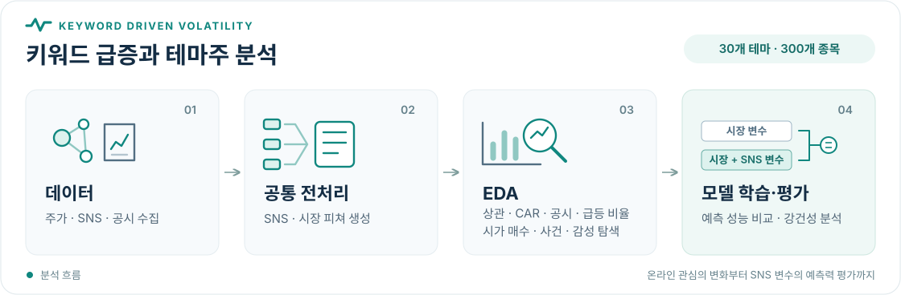
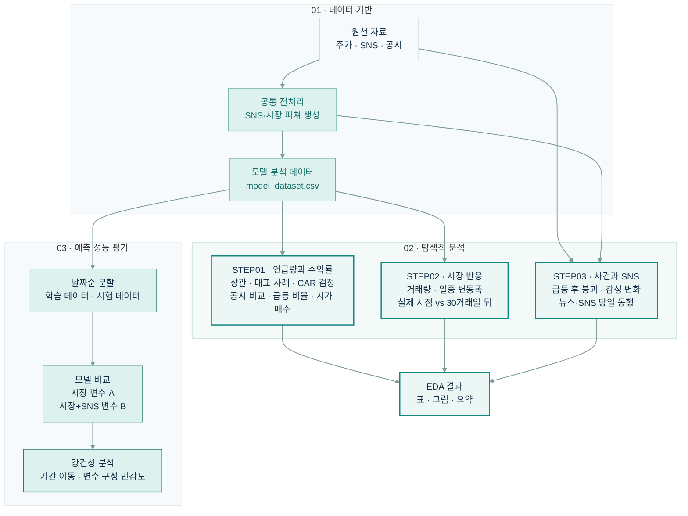

# KeywordDrivenVolatility

## 🎯 프로젝트 소개


온라인 키워드의 언급량·감성 변화와 테마주 주가 움직임을 결합한 키워드 급증·급등 이후 가격 변화 관계 탐색

탐색적 데이터 분석을 통한 주요 패턴 확인

시계열 분리 데이터에서 SNS 변수가 주가 기반 모델의 예측 성능을 높이는지 평가



## 🗂️ 데이터


원본 자료 저장 위치는 `data/raw/`, 전처리·모델 입력 자료 저장 위치는 `data/processed/`입니다.<br>
공개 저장소에는 프로젝트 코드와 데이터 명세를 둡니다.<br>
SNS 원본과 행 단위 파생 데이터·분석 산출물은 포함하지 않습니다.<br>

| 구분 | 파일 | 설명 |
| --- | --- | --- |
| 원본 | `data/raw/theme_candidates.csv` | 키워드·테마별 후보 종목 목록 |
| 원본 | `data/raw/theme_stock_daily.csv` | FinanceDataReader를 통해 수집한 종목별 OHLCV와 시장지수 정보 |
| 비공개 원본 | `data/raw/sns_daily_mentions_sentiment.csv` | 재현 시 별도 확보가 필요한 키워드별 일일 언급량·감성 자료 |
| 원본 | `data/raw/opendart/opendart_disclosures.csv` | OpenDART 공시 목록 |
| 원본 | `data/raw/opendart/opendart_financials.csv` | OpenDART 재무제표 자료 |
| 비공개 전처리 | `data/processed/sns_keyword_features.csv` | SNS 원자료에서 생성되는 키워드별 피처 |
| 전처리 | `data/processed/market_stock_features.csv` | 종목·날짜별 시장 피쳐 |
| 모델 입력 | `data/processed/model_dataset.csv` | 종목·거래일별 모델 입력 변수와 정답 |
| 학습·시험 | `data/processed/train.csv`, `data/processed/test.csv` | 날짜 기준으로 나눈 학습 데이터와 시험 데이터 |
| EDA 준비 데이터 | `data/processed/eda/step03/` | STEP03 분석용 종목별·SNS 일별 데이터 및 점검 자료 |

재현에 필요한 파일과 SNS 원자료의 필수 컬럼 명세는 [데이터 요구사항](docs/data_requirements.md)을 참고하세요.

## 🔄 분석 흐름




## 📊 결과와 대시보드

### Streamlit 대시보드

배포 주소: `[배포 후 여기에 Streamlit 앱 주소를 입력하세요]`

데이터가 포함되지 않은 공개 복사본에서는 데이터 기반 결과를 재현할 수 없습니다.<br>
로컬 데이터와 산출물을 별도로 준비하면 EDA·모델 분석을 실행할 수 있습니다.<br>
앱은 `streamlit run src/streamlit/app.py`로 실행합니다.<br>
필요한 파일이 없으면 데이터 소개 화면에서 준비 경로와 명세를 확인할 수 있습니다.<br>

## 🚀 실행 방법

### 🧰 환경 설정

Python 3.12.9 기준 환경입니다.
프로젝트 루트에서 패키지를 설치합니다.

```bash
python3 -m pip install -r requirements.txt
```


### 🧹 공통 데이터 전처리

raw 데이터를 준비한 뒤 프로젝트 루트에서 실행합니다.<br>
EDA·모델 분석 공통 SNS·시장 피쳐를 생성합니다.<br>

```bash
python3 src/preprocessing/preprocess_sns_data.py
python3 src/preprocessing/preprocess_market_data.py
```

주가·공시 raw 데이터 수집 방법: [수집·전처리 사용법](docs/preprocessing_usage.md)

### 🔎 EDA

STEP01: SNS 언급량과 초과수익률의 연관·대표 사례, CAR 구간 검정, 공시 유무 비교, 일별 급등 비율·다음 날 시가 매수 분석

STEP02: 화제 전후 거래량·변동폭의 실제·가짜 시점 반응 비교

STEP03: 급등 이후 붕괴와 SNS 변화 탐색

STEP01·02 실행 전 `model_dataset.csv` 생성

STEP03 실행 전 별도 분석용 데이터 준비

```bash
python3 src/preprocessing/build_model_dataset.py
python3 src/eda/step01_mention_association.py
python3 src/eda/step02_volume_response.py
python3 src/eda/step03_prepare_data.py
python3 src/eda/step03_events.py
python3 src/eda/step03_sentiment.py
python3 src/eda/step03_comovement.py
```

STEP01 결과 저장 위치: `eda-outputs/step01/`

STEP01은 `data/processed/model_dataset.csv`와 `data/raw/theme_stock_daily.csv`를 사용합니다. <br>`--input`, `--stock`, `--output`으로 경로를 변경할 수 있습니다. <br>표는 `tables/`, 그림은 `figures/`에 저장합니다. EDA 3~5의 이벤트 창은 Day −5부터 +10까지이며, 시가 매수 분석은 Day 0·1·2 밤 기준 다음 날 시가에 매수해 1·2·3·5거래일 보유합니다.<br>공시 그룹은 Day 0의 최근 3거래일 공시 건수로 구분하며, 공시의 인과효과를 검증한 결과는 아닙니다.

STEP02 결과 저장 위치: `eda-outputs/step02/`

STEP03 준비 데이터 저장 위치: `data/processed/eda/step03/`

STEP03 결과 저장 위치: `eda-outputs/step03/`

입력·산출물 상세: [EDA 사용법](docs/eda_usage.md)

### 🧠 모델 학습 및 평가

공통 데이터 전처리와 `model_dataset.csv` 생성 후 프로젝트 루트에서 실행합니다.
아래 명령은 날짜 기준 학습·시험 분할부터 수행합니다.
EDA 결과 파일은 필요하지 않습니다.

```bash
python3 src/model/data_split.py
python3 src/model/train.py --model all
python3 src/model/test.py --model all
python3 src/model/robustness.py
```

모델별 실행 옵션: [학습 스크립트](src/model/train.py), [평가 스크립트](src/model/test.py), [강건성 분석 스크립트](src/model/robustness.py)

## 🗃️ 프로젝트 구조


```text
KeywordDrivenVolatility/
├── data/
│   ├── raw/                           # 주가·SNS·공시 원자료
│   └── processed/                     # 전처리·모델 입력 데이터
│       └── eda/step03/                # STEP03 분석 준비 데이터
├── docs/                              # 프로젝트 문서와 참고 자료
│   ├── assets/analysis-flow.svg
│   ├── commit_conventions.md
│   ├── eda_usage.md
│   ├── preprocessing_usage.md
├── eda-outputs/                       # STEP별 분석 결과
│   ├── step01/                         # tables/ · figures/
│   ├── step02/                         # tables/ · figures/
│   └── step03/                         # tables/ · figures/
├── model-outputs/                     # 모델과 평가 결과
│   ├── models/
│   └── results/
├── presentation/                      # 발표 자료
├── src/
│   ├── eda/                            # STEP01~03 EDA와 공통 보고 도구
│   │   ├── step01_mention_association.py
│   │   ├── step02_volume_response.py
│   │   ├── step03_*.py
│   │   └── eda_reporting.py
│   ├── model/                          # 데이터 분할·학습·평가·강건성 분석
│   ├── preprocessing/                  # 원자료 수집·전처리·모델 데이터 생성
│   └── streamlit/                      # 대시보드 앱·페이지·리소스
├── README.md
└── requirements.txt                   # Python 패키지 의존성
```

## 📚 팀원 및 관련 문서


팀원 및 역할 정보: 현재 프로젝트 문서에 미기재

- [EDA 사용법](docs/eda_usage.md)
- [수집·전처리 사용법](docs/preprocessing_usage.md)
- [커밋 메시지 규칙](docs/commit_conventions.md)
